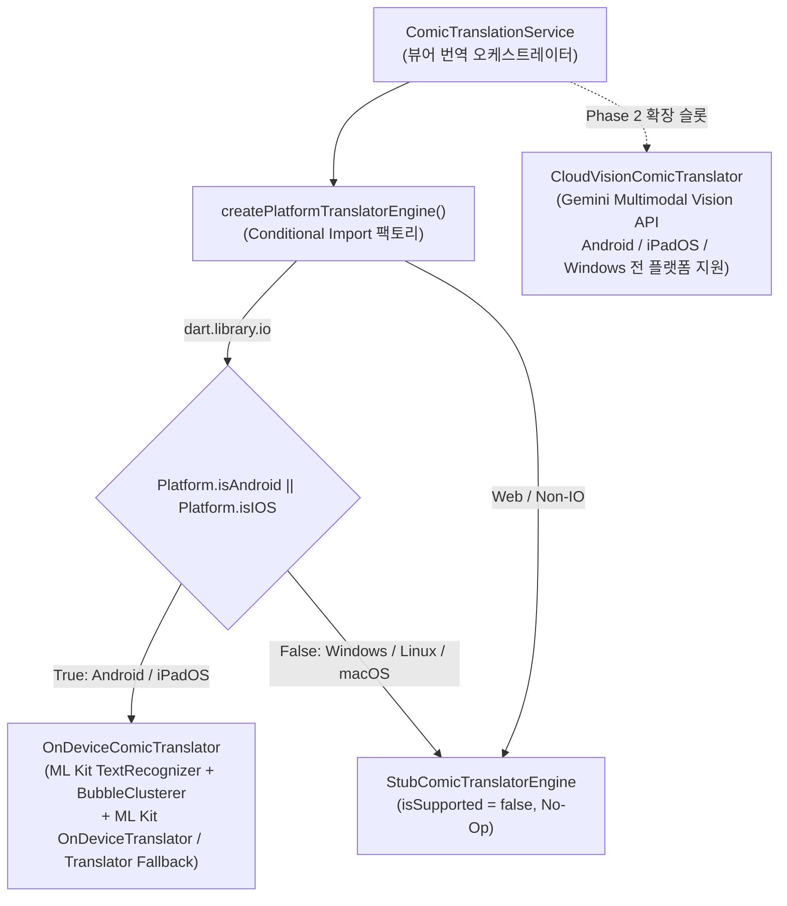
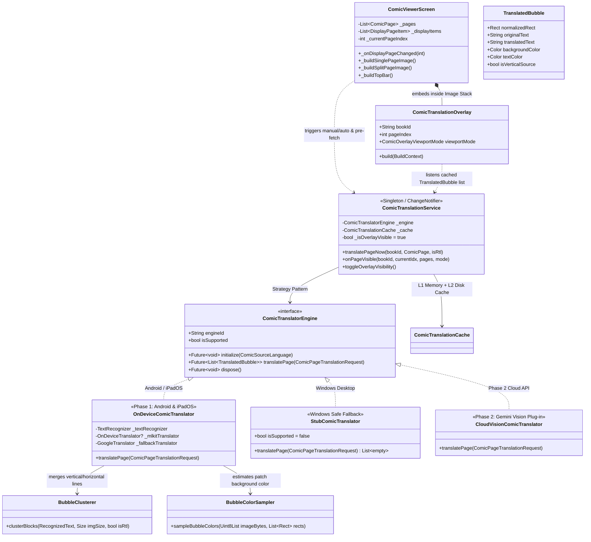
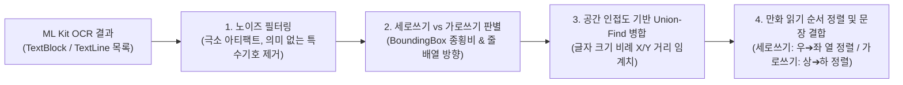
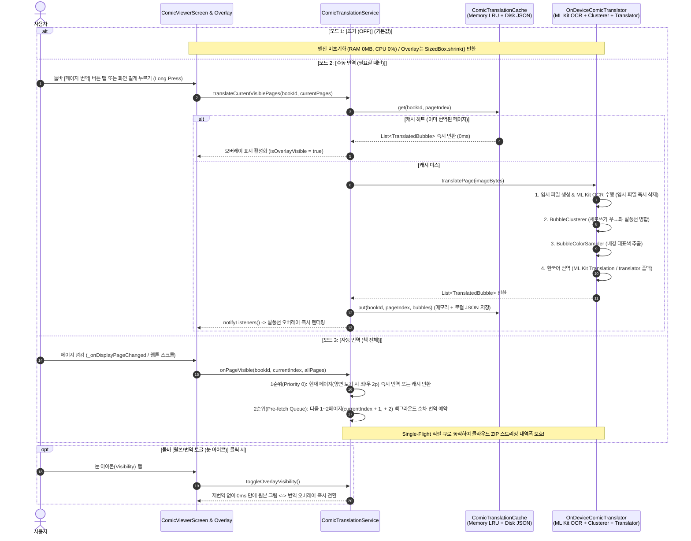

# [아키텍처 설계서] 만화 뷰어 실시간 AI 말풍선 인식(OCR) 및 인플레이스(In-Place) 오버레이 번역 시스템 (Phase 1 & Phase 2 확장형)

> **문서 목적**: 현재 다중 클라우드 만화/이북 뷰어(`cloud_comic_viewer` - Android / iPadOS / Windows 지원)의 기존 페이지 렌더링, 핀치 줌/팬(`InteractiveViewer`), 양면/분할 보기(`Single` / `Split` / `Spread` / `Webtoon`), 클라우드 압축 파일 실시간 스트리밍(`ZipStreamReader`)에 **어떠한 사이드 이펙트(성능 저하, 줌 좌표 틀어짐, 네트워크 대역폭 경쟁, 크로스 플랫폼 빌드 깨짐)도 주지 않고**, 구글 렌즈(카메라 번역)처럼 **만화 이미지 속 외국어 말풍선을 인식·번역해 원본 글자 위에 깔끔하게 덮어씌우는 AI 이미지 번역 모듈**을 도입하기 위한 구조 변경 설계서입니다.

---

## 0. 현행 시스템(`pubspec.yaml` 및 `ComicViewerScreen` 구조) 정밀 분석 결과

현재 프로젝트의 코드베이스를 정밀 분석한 결과, AI 말풍선 번역 모듈 설계 시 반드시 고려해야 할 **4가지 핵심 아키텍처 특성**은 다음과 같습니다.

1. **`InteractiveViewer` 기반 줌/팬 및 4종 화면 표시 모드 ([`comic_viewer_screen.dart`](file:///D:/My%20Documents/AI/cloud_comic_viewer/lib/ui/screens/comic_viewer_screen.dart), [`display_page_item.dart`](file:///D:/My%20Documents/AI/cloud_comic_viewer/lib/models/display_page_item.dart))**:
   - 현재 뷰어는 **페이지 모드(`PageView.builder`)**와 **웹툰 모드(`ScrollablePositionedList.builder`)**를 지원하며, 페이지 모드에서는 각 화면 단위가 [`InteractiveViewer`](file:///D:/My%20Documents/AI/cloud_comic_viewer/lib/ui/screens/comic_viewer_screen.dart#L1205-L1223)(`minScale: 1.0`, `maxScale: 4.0`, 더블탭 `2.5x` 줌)로 감싸져 있습니다.
   - 특히 [`DisplayPageBuilder`](file:///D:/My%20Documents/AI/cloud_comic_viewer/lib/models/display_page_item.dart#L46-L278)를 통해 하나의 원본 페이지([`ComicPage`](file:///D:/My%20Documents/AI/cloud_comic_viewer/lib/models/comic_page.dart))가 화면 방향과 설정에 따라 4가지 형태(`DisplayItemType`)로 렌더링됩니다:
     1. **`single` ([`_buildSinglePageImage`](file:///D:/My%20Documents/AI/cloud_comic_viewer/lib/ui/screens/comic_viewer_screen.dart#L1245-L1326))**: [`ImageDimensionUtils.calculateDisplaySize()`](file:///D:/My%20Documents/AI/cloud_comic_viewer/lib/utils/image_dimension_utils.dart#L18-L69)로 계산된 정확한 `SizedBox(width: displaySize.width, height: displaySize.height)` 내부에 `Image.memory`를 렌더링합니다.
     2. **`spread` ([`_buildSpreadPageImage`](file:///D:/My%20Documents/AI/cloud_comic_viewer/lib/ui/screens/comic_viewer_screen.dart#L1375-L1401))**: `Row` 내부의 좌/우 `Expanded` 영역이 각각 `_buildSinglePageImage(leftPage)`와 `_buildSinglePageImage(rightPage)`를 그대로 재사용하여 호출합니다.
     3. **`splitLeft` / `splitRight` ([`_buildSplitPageImage`](file:///D:/My%20Documents/AI/cloud_comic_viewer/lib/ui/screens/comic_viewer_screen.dart#L1339-L1372) ➔ [`SplitImageView`](file:///D:/My%20Documents/AI/cloud_comic_viewer/lib/ui/screens/comic_viewer_screen.dart#L1727-L1857))**: 양면 스캔된 가로 와이드 이미지를 세로 화면에서 볼 때 [`SplitImagePainter`](file:///D:/My%20Documents/AI/cloud_comic_viewer/lib/ui/screens/comic_viewer_screen.dart#L1802-L1857)가 원본의 왼쪽 50%(`0.0 ~ 0.5`) 또는 오른쪽 50%(`0.5 ~ 1.0`)를 `dstRect` 영역에 그립니다.
   - **설계 반영**:
     - 말풍선 오버레이 위젯(`ComicTranslationOverlay`)을 `InteractiveViewer` 바깥이 아닌, **렌더링된 이미지와 완전히 동일한 `SizedBox(width: displaySize.width, height: displaySize.height)` 내부의 `Stack` 자식**으로 배치합니다.
     - 이렇게 하면 핀치 줌(1.0x~4.0x), 더블탭 확대(2.5x), 팬(Pan) 이동 시 Flutter 엔진의 동일한 `Matrix4` 변환 행렬이 이미지와 오버레이에 동시에 적용되어 **줌 좌표 틀어짐이나 글자 밀림이 물리적으로 0%가 됩니다**.
     - 또한 `_buildSinglePageImage`와 `SplitImageView` 두 곳에만 오버레이 레이어를 부착하면 **1페이지 보기, 두 장 합쳐보기(Spread), 좌우 나눠보기(Split), 웹툰 세로 스크롤 모드 모두에서 단일 정규화 좌표(`0.0 ~ 1.0`) 캐시 데이터로 완벽히 동작**합니다.

2. **클라우드 ZIP 실시간 Range 스트리밍 및 메모리 바이트 캐싱 보호 ([`zip_stream_reader.dart`](file:///D:/My%20Documents/AI/cloud_comic_viewer/lib/services/zip_stream_reader.dart), [`comic_page.dart`](file:///D:/My%20Documents/AI/cloud_comic_viewer/lib/models/comic_page.dart))**:
   - Google Drive, Baidu, TeraBox, Naver MYBOX, MEGA(`MegaCloudRangeReader` AES-128-CTR 실시간 블록 복호화), Box, Dropbox 등에서 ZIP 전체를 다운로드하지 않고 Central Directory만 파싱한 뒤 페이지별로 `byteGetter`를 통해 HTTP `Range` 요청으로 압축을 해제합니다.
   - [`ComicPage.getBytes()`](file:///D:/My%20Documents/AI/cloud_comic_viewer/lib/models/comic_page.dart#L30-L40)는 한 번 로드된 이미지 바이트(`Uint8List`)를 `_cachedBytes`에 메모이즈(Memoize)하며, [`_preloadAdjacentPages()`](file:///D:/My%20Documents/AI/cloud_comic_viewer/lib/ui/screens/comic_viewer_screen.dart#L530-L544)가 현재 페이지 기준 앞뒤 페이지를 프리페치합니다.
   - **설계 반영**:
     - 번역 엔진은 클라우드 네트워크를 직접 호출하지 않고 오직 `ComicPage.getBytes()`가 반환하는 메모리 내 `Uint8List`만 입력으로 받습니다.
     - **[자동 번역]** 모드의 백그라운드 선행 번역(Pre-fetch: 다음 1~2페이지)은 **단일 직렬 큐(Single-Flight Sequential Queue, 동시 실행 수 = 1)**로 동작하여, `ZipStreamReader`의 Range 스트리밍 대역폭이나 클라우드 API Rate Limit(429/403)과 절대 경쟁하지 않도록 설계합니다.

3. **터치 제스처(좌우/상하 탭 페이지 넘김, 더블탭 줌)와 수동 번역 제스처의 비충돌 설계**:
   - 현재 [`comic_viewer_screen.dart`](file:///D:/My%20Documents/AI/cloud_comic_viewer/lib/ui/screens/comic_viewer_screen.dart#L1193-L1204)의 `GestureDetector`는 `onDoubleTapDown`, `onDoubleTap`, `onTapUp`만 사용 중이며 **`onLongPress`는 비어 있습니다**.
   - **설계 반영**: `[수동 번역 (필요할 때만)]` 모드에서 기존 좌/우 탭 페이지 넘김 및 더블탭 줌에 전혀 영향을 주지 않도록, **① 상단/하단 툴바의 `[페이지 번역]` 전용 버튼 탭**과 **② 화면 길게 누르기(`onLongPress`, 줌 상태가 아닐 때 또는 확대 중 말풍선 확인 시)**로 현재 페이지(양면 보기 시 좌·우 페이지 모두) 번역을 즉시 트리거합니다.

4. **일본 만화 자동 감지([`MangaDetectionUtils`](file:///D:/My%20Documents/AI/cloud_comic_viewer/lib/utils/manga_detection_utils.dart)) 및 읽기 방향 연동**:
   - 현재 파일명/폴더명 및 읽기 방향(`ReadingDirection.rightToLeft` vs `leftToRight`)을 통해 일본 만화 여부를 이미 식별하고 있습니다.
   - **설계 반영**: 말풍선 병합(`BubbleClusterer`) 시 `readingDirection == ReadingDirection.rightToLeft`이거나 세로쓰기 텍스트 블록(`height > width * 1.2`)이 감지되면 **일본 만화 세로쓰기 표준 순서(말풍선 내 오른쪽 열 ➔ 왼쪽 열, 각 열 내 위 ➔ 아래)**로 문장을 병합하여 번역 품질을 극대화합니다.

---

## 1. 플랫폼별 패키지 호환성 전략 (Cross-Platform Compatibility Strategy)

본 프로젝트는 **Android**, **iPadOS(iOS)**, **Windows Desktop** 3개 플랫폼을 단일 코드베이스로 지원합니다.
`google_mlkit_text_recognition` 및 `google_mlkit_translation`은 **Android / iOS 전용 네이티브 플러그인**이므로, Windows 빌드 깨짐 및 런타임 `MissingPluginException`을 원천 차단하기 위해 아래의 **플랫폼 분기(Conditional Import) 및 의존성 격리 전략**을 적용합니다.

### 1.1. 파이프라인 단계별 플랫폼 호환성 매트릭스

| 파이프라인 단계 | Android (ARM64 / x86_64) | iPadOS / iOS (Apple Silicon) | Windows Desktop (x64) | 미지원/오프라인 시 Fail-Safe Fallback |
| :--- | :--- | :--- | :--- | :--- |
| **① 텍스트 인식 (OCR)**<br/>*(텍스트 블록 + BoundingBox 추출)* | **`google_mlkit_text_recognition`**<br/>*(Latin / Japanese / Chinese 스크립트 네이티브 가속)* | **`google_mlkit_text_recognition`**<br/>*(Apple Vision / ML Kit 네이티브 가속)* | **`StubComicTranslatorEngine`**<br/>*(Conditional Import로 ML Kit 컴파일/호출 완전 격리)* | Windows에서 수동/자동 번역 호출 시 크래시 없이 *"Windows 환경에서는 추후 클라우드 AI 번역(Phase 2)에서 지원됩니다"* 토스트 1회 안내 |
| **② 말풍선 클러스터링 & 배경색 추정**<br/>*(순수 Dart 알고리즘)* | **`BubbleClusterer` + `BubbleColorSampler`**<br/>*(백그라운드 `Isolate.run` 비동기 처리)* | **`BubbleClusterer` + `BubbleColorSampler`**<br/>*(백그라운드 `Isolate.run` 비동기 처리)* | **`BubbleClusterer` + `BubbleColorSampler`**<br/>*(100% 순수 Dart 코드로 모든 OS 호환)* | 이미지 디코딩 실패 시 기본 말풍선 배경색(`#FFFFFF`) 및 검정 글자(`#1A1A1A`)로 안전 폴백 |
| **③ 다국어 ➔ 한국어 번역**<br/>*(1순위: 온디바이스 / 2순위: 무료 API 폴백)* | **1순위: `google_mlkit_translation`**<br/>*(온디바이스 오프라인 신경망 번역)*<br/>**2순위: `translator`** *(언어팩 미다운로드 시 무료 번역 폴백)* | **1순위: `google_mlkit_translation`**<br/>*(온디바이스 오프라인 신경망 번역)*<br/>**2순위: `translator`** *(언어팩 미다운로드 시 무료 번역 폴백)* | **`translator` (순수 Dart 패키지)**<br/>*(Phase 2 Cloud Vision OCR 연동 시 즉시 재사용 가능)* | 네트워크 오프라인 & 언어팩 미설치 시 원문 유지 또는 사용자에게 언어팩 다운로드 상태 토스트 표시 |

---

### 1.2. 추가할 패키지 및 네이티브 빌드 영향도 분석 (`pubspec.yaml`)

```yaml
dependencies:
  # [AI 만화 말풍선 번역 - Phase 1 온디바이스 OCR & 번역]
  google_mlkit_text_recognition: ^0.15.0  # Android & iPadOS 전용 (Latin, Japanese, Chinese 스크립트 포함)
  google_mlkit_translation: ^0.13.0       # Android & iPadOS 전용 (온디바이스 오프라인 한/일/영/중 번역)
  translator: ^1.0.3+1                    # 순수 Dart 기반 무료 Google 번역 폴백 (언어팩 다운로드 전 즉시 번역 지원)
```

1. **Android (`android/app/build.gradle.kts`) 영향도**:
   - `google_mlkit_text_recognition`은 일본어(`text-recognition-japanese`), 중국어(`text-recognition-chinese`), 라틴/영어(`text-recognition`) 모델을 지원합니다.
   - 기존 `minSdk` 및 Gradle 설정과 100% 호환되며 기존 클라우드 인증이나 PDF(`pdfrx`) 플러그인과 충돌하지 않습니다.
2. **iPadOS / iOS (`ios/Podfile`) 영향도**:
   - `GoogleMLKit/TextRecognition`, `GoogleMLKit/TextRecognitionJapanese`, `GoogleMLKit/TextRecognitionChinese`, `GoogleMLKit/Translate` Pod가 자동 링크됩니다.
3. **Windows (`windows/CMakeLists.txt`) 영향도 (Zero Build Breakage)**:
   - 위 두 ML Kit 패키지는 `pubspec.yaml`의 `flutter.plugin.platforms`에 `android`와 `ios`만 선언되어 있으므로, **Windows CMake 빌드 시 `windows/flutter/generated_plugins.cmake`에 아예 포함되지 않습니다(C++ 컴파일 에러 가능성 0%)**.
   - 단, Dart 레이어에서 Windows 실행 중 ML Kit의 `MethodChannel`을 호출하지 않도록 아래와 같이 **Conditional Import 팩토리**로 완벽히 격리합니다.

---

### 1.3. 크로스 플랫폼 빌드/런타임 방어 구조 (Conditional Import & Platform Factory)



```dart
// [설계 예시] lib/services/ai_translation/engines/platform_translator_factory.dart
import '../comic_translator_engine.dart';
import 'platform_translator_factory_stub.dart'
    if (dart.library.io) 'platform_translator_factory_io.dart';

ComicTranslatorEngine createDefaultOnDeviceEngine() => createPlatformOnDeviceEngine();
```

```dart
// [설계 예시] lib/services/ai_translation/engines/platform_translator_factory_io.dart
import 'dart:io';
import '../comic_translator_engine.dart';
import 'on_device_comic_translator.dart';
import 'stub_comic_translator.dart';

ComicTranslatorEngine createPlatformOnDeviceEngine() {
  if (Platform.isAndroid || Platform.isIOS) {
    return OnDeviceComicTranslator();
  }
  // Windows 데스크톱 환경에서는 ML Kit 인스턴스를 생성하지 않고 안전한 Stub 반환
  return StubComicTranslator(
    unsupportedReason: 'Windows 데스크톱 환경에서는 온디바이스 ML Kit OCR이 비활성화되어 있습니다.',
  );
}
```

---

## 2. 최소 침습 수정 파일 목록 (Minimal Invasive Modification List)

기존 만화 뷰어의 렌더링 성능과 스트리밍 안정성을 100% 보존하기 위해, **기존 파일 수정은 단 5개 파일(설정 모델 확장 및 뷰어 위젯 `Stack` 오버레이 슬롯 연결)**로 최소화하고 모든 OCR·클러스터링·번역·캐싱 로직은 **`lib/models/ai_translation/`**, **`lib/services/ai_translation/`**, **`lib/ui/widgets/comic_translation_overlay.dart`** 신규 모듈로 완전히 분리합니다.

### 2.1. 기존 파일 수정 목록 (총 5개 파일 - Zero Side-Effect)

| 순번 | 대상 파일 경로 | 수정 범위 및 상세 내용 (침습도) | 사이드 이펙트 방어 대책 |
| :---: | :--- | :--- | :--- |
| **1** | [`pubspec.yaml`](file:///D:/My%20Documents/AI/cloud_comic_viewer/pubspec.yaml) | **의존성 3종 추가 (낮음)**<br/>- `google_mlkit_text_recognition`, `google_mlkit_translation`, `translator` 추가 | 기존 `archive`, `pdfrx`, `http`, `dio`, `pointycastle` 등 기존 패키지 버전 변경 없음 |
| **2** | [`lib/models/viewer_settings.dart`](file:///D:/My%20Documents/AI/cloud_comic_viewer/lib/models/viewer_settings.dart) | **번역 설정 Enum 및 필드 추가 (매우 낮음)**<br/>- `ComicTranslationMode` (`off`, `manual`, `auto` - 기본값 `off`)<br/>- `ComicSourceLanguage` (`auto`, `japanese`, `english`, `chinese` - 기본값 `auto`)<br/>- `ViewerSettings`에 `translationMode`, `translationSourceLang` 필드 및 `toJson`/`fromJson` 하위 호환 직렬화 추가 | 기본값이 `ComicTranslationMode.off`이며, 기존 설정 JSON 키와 100% 호환 유지 |
| **3** | [`lib/services/viewer_settings_service.dart`](file:///D:/My%20Documents/AI/cloud_comic_viewer/lib/services/viewer_settings_service.dart) | **설정 변경 헬퍼 메서드 2개 추가 (매우 낮음)**<br/>- `setTranslationMode(ComicTranslationMode mode)`<br/>- `setTranslationSourceLang(ComicSourceLanguage lang)` | 기존 설정 저장소(`SharedPreferences`) 로직 그대로 사용 |
| **4** | [`lib/ui/widgets/viewer_settings_dialog.dart`](file:///D:/My%20Documents/AI/cloud_comic_viewer/lib/ui/widgets/viewer_settings_dialog.dart) | **뷰어 설정 패널에 AI 번역 섹션 추가 (낮음)**<br/>- **AI 만화 번역 모드** `SegmentedButton` (`끄기 (OFF)` / `수동 번역` / `자동 번역`)<br/>- 번역 모드 활성화(`!= off`) 시 **원본 만화 언어 선택** (`자동(일본어 우선)` / `일본어` / `영어` / `중국어`) 칩 표시 | `SingleChildScrollView`로 바텀시트 스크롤을 보장하여 작은 화면에서도 오버플로우 방지 |
| **5** | [`lib/ui/screens/comic_viewer_screen.dart`](file:///D:/My%20Documents/AI/cloud_comic_viewer/lib/ui/screens/comic_viewer_screen.dart) | **툴바 버튼 & 이미지 `Stack` 오버레이 슬롯 연결 (낮음)**<br/>1. **상단 툴바(`_buildTopBar`)**: 번역 모드가 켜져 있거나 현재 페이지 번역본이 있을 때 **`[페이지 번역]` 버튼** 및 **`[원본/번역 토글(눈 아이콘)]` 버튼** 표시<br/>2. **롱프레스 훅**: `GestureDetector`에 `onLongPress` 연결 (수동/자동 모드일 때 현재 페이지 즉시 번역 트리거)<br/>3. **페이지 변경 훅**: `_onDisplayPageChanged` / `_jumpToPage` / 웹툰 스크롤 시 `ComicTranslationService`에 현재 페이지 및 다음 1~2페이지 Pre-fetch 알림<br/>4. **렌더링 슬롯**: `_buildSinglePageImage`의 `SizedBox(width: displaySize.width, height: displaySize.height)`와 `SplitImageView`를 `Stack`으로 감싸고 `ComicTranslationOverlay` 배치 | `ComicTranslationMode.off`일 때는 `ComicTranslationOverlay`가 `SizedBox.shrink()`를 즉시 반환하고 엔진을 초기화하지 않으므로 기존 렌더링 트리 및 메모리와 100% 동일 |

---

### 2.2. 신규 생성 파일 목록 (완전 격리된 독립 모듈 - 총 12개 파일)

```text
lib/
 ├── models/
 │    └── ai_translation/
 │         ├── translated_bubble.dart                 # 말풍선 데이터 모델 (normalizedRect 0.0~1.0, originalText, translatedText, backgroundColor, textColor, isVertical)
 │         └── page_translation_result.dart           # 페이지 단위 번역 결과 및 상태 모델 (bookId, pageIndex, bubbles, timestamp, status)
 ├── services/
 │    └── ai_translation/
 │         ├── comic_translator_engine.dart           # [Strategy Interface] 추상 번역 엔진 인터페이스 (Phase 1 온디바이스 / Phase 2 클라우드 비전 API 확장용)
 │         ├── comic_translation_service.dart         # 최상위 Facade & ChangeNotifier (모드 관리, 현재 페이지 번역, 다음 1~2p Pre-fetch 큐, 원본/번역 눈 토글 상태)
 │         ├── comic_translation_cache.dart           # 2계층 캐시 (L1: 메모리 LRU 캐시 + L2: 로컬 임시 JSON 캐시 - 책 ID + 페이지 인덱스 기준 재번역 0회 보장)
 │         ├── bubble_clusterer.dart                  # 인접 텍스트 블록 말풍선 병합기 (일본 만화 세로쓰기 우→좌 / 가로쓰기 상→하 문맥 클러스터링)
 │         ├── bubble_color_sampler.dart              # 말풍선 테두리 픽셀 샘플링 기반 배경 대표색(흰색/검은색/세피아 등) 및 고대비 글자색 자동 추정기
 │         └── engines/
 │              ├── platform_translator_factory.dart      # Conditional Import 진입점
 │              ├── platform_translator_factory_stub.dart # Non-IO 기본 스텁 팩토리
 │              ├── platform_translator_factory_io.dart   # dart:io 플랫폼 분기 (Android/iOS -> OnDevice, Windows -> Stub)
 │              ├── on_device_comic_translator.dart       # [Phase 1 구현] ML Kit TextRecognition + BubbleClusterer + ML Kit Translation (및 translator 폴백)
 │              ├── stub_comic_translator.dart            # Windows 데스크톱 안전 비활성화(No-Op) 스텁 엔진
 │              └── cloud_vision_comic_translator.dart    # [Phase 2 스켈레톤] 향후 Gemini Multimodal Vision API 등 클라우드 엔진 플러그인 슬롯
 └── ui/
      └── widgets/
           └── comic_translation_overlay.dart         # 이미지 Stack 동기화 오버레이 위젯 (Single/Spread/Split 좌표 변환, 둥근 배경 패치, Auto-sizing 텍스트 렌더러)
```

---

## 3. Phase 1 상세 아키텍처 및 핵심 알고리즘 설계

### 3.1. 전체 클래스 구조 및 Strategy Pattern 다이어그램



---

### 3.2. 확장형 인터페이스 및 공통 데이터 모델 명세 (요구사항 1)

#### (1) 공통 데이터 모델: `TranslatedBubble` (`lib/models/ai_translation/translated_bubble.dart`)
- 원본 이미지 해상도(`width`, `height`)에 독립적인 **`0.0 ~ 1.0` 정규화 좌표(`Rect`)**를 사용하여, 화면 회전, `FitMode` 변경(`contain`, `fitWidth`, `fitHeight`), 핀치 줌, 양면 보기(`spread`), 좌우 분할(`splitLeft`/`splitRight`) 시에도 재계산 없이 즉시 픽셀 좌표로 투영됩니다.

```dart
import 'package:flutter/material.dart';

class TranslatedBubble {
  /// 원본 이미지 전체 크기 대비 정규화된 좌표 (left, top, right, bottom ∈ [0.0, 1.0])
  final Rect normalizedRect;

  /// 말풍선 단위로 병합된 원문 텍스트
  final String originalText;

  /// 한국어로 번역된 텍스트
  final String translatedText;

  /// 원본 말풍선 테두리 픽셀 샘플링으로 추정한 배경 대표색 (기본값: Colors.white)
  final Color backgroundColor;

  /// 배경색의 명도(Luminance)에 따라 자동 결정된 고대비 글자색 (Colors.black87 또는 Colors.white)
  final Color textColor;

  /// 원본 텍스트가 세로쓰기(일본 만화 등)였는지 여부
  final bool isVerticalSource;

  const TranslatedBubble({
    required this.normalizedRect,
    required this.originalText,
    required this.translatedText,
    this.backgroundColor = Colors.white,
    this.textColor = const Color(0xFF1A1A1A),
    this.isVerticalSource = false,
  });

  Map<String, dynamic> toJson() => {
        'l': normalizedRect.left,
        't': normalizedRect.top,
        'r': normalizedRect.right,
        'b': normalizedRect.bottom,
        'orig': originalText,
        'trans': translatedText,
        'bg': backgroundColor.toARGB32(),
        'fg': textColor.toARGB32(),
        'vert': isVerticalSource,
      };

  factory TranslatedBubble.fromJson(Map<String, dynamic> json) => TranslatedBubble(
        normalizedRect: Rect.fromLTRB(
          (json['l'] as num).toDouble(),
          (json['t'] as num).toDouble(),
          (json['r'] as num).toDouble(),
          (json['b'] as num).toDouble(),
        ),
        originalText: json['orig'] as String? ?? '',
        translatedText: json['trans'] as String? ?? '',
        backgroundColor: Color(json['bg'] as int? ?? 0xFFFFFFFF),
        textColor: Color(json['fg'] as int? ?? 0xFF1A1A1A),
        isVerticalSource: json['vert'] as bool? ?? false,
      );
}
```

#### (2) 전략 인터페이스: `ComicTranslatorEngine` (`lib/services/ai_translation/comic_translator_engine.dart`)
```dart
import 'dart:typed_data';
import '../../models/ai_translation/translated_bubble.dart';
import '../../models/viewer_settings.dart';

class ComicPageTranslationRequest {
  final String bookId;
  final int pageIndex;
  final Uint8List imageBytes;
  final int imageWidth;
  final int imageHeight;
  final ComicSourceLanguage sourceLanguage;
  final String targetLanguage; // 기본 'ko'
  final bool isRightToLeftManga;

  const ComicPageTranslationRequest({
    required this.bookId,
    required this.pageIndex,
    required this.imageBytes,
    required this.imageWidth,
    required this.imageHeight,
    required this.sourceLanguage,
    this.targetLanguage = 'ko',
    this.isRightToLeftManga = true,
  });
}

abstract class ComicTranslatorEngine {
  String get engineId;
  String get displayName;

  /// 현재 OS 플랫폼에서 해당 엔진이 동작 가능한지 여부 (Windows에서 OnDevice는 false)
  bool get isSupported;

  /// 언어 스크립트별 OCR 및 번역기 초기화 (Lazy Initialization)
  Future<void> initialize({required ComicSourceLanguage sourceLanguage});

  /// 단일 만화 페이지 이미지 바이트에서 말풍선 인식 + 병합 + 배경색 추정 + 한국어 번역 수행
  Future<List<TranslatedBubble>> translatePage(ComicPageTranslationRequest request);

  /// 뷰어 종료 또는 번역 모드 OFF 전환 시 네이티브 리소스 즉시 해제
  Future<void> dispose();
}
```

---

### 3.3. 만화 특화 말풍선 병합(Clustering) 및 일본 만화 세로쓰기 정렬 알고리즘 (`BubbleClusterer` - 요구사항 2)

ML Kit OCR(`google_mlkit_text_recognition`)은 한 말풍선 안의 대사를 여러 개의 줄(`TextLine`) 또는 여러 개의 블록(`TextBlock`)으로 쪼개서 반환합니다. 이를 줄 단위로 각각 번역하면 문맥이 깨지고 오버레이 박스가 조각나므로, **`BubbleClusterer`**가 아래 4단계 알고리즘으로 하나의 말풍선 단위로 병합합니다.



1. **노이즈 및 비-대사 영역 필터링**:
   - 이미지 전체 면적 대비 너무 작은 점/선 노이즈(`width < 8px` 또는 `height < 8px`), 한글/영문/한자/가나(히라가나·가타카나)가 1글자도 포함되지 않은 순수 기호(`...`, `!?`, `///` 단독 블록)를 1차 필터링합니다.
2. **세로쓰기(Vertical) vs 가로쓰기(Horizontal) 자동 판별**:
   - 각 `TextLine` 또는 `TextBlock`의 `boundingBox`에서 `height > width * 1.15`이거나, 원본 언어가 일본어/중국어이면서 글자 수 대비 세로 길이가 긴 경우 **세로쓰기(`isVertical = true`)**로 분류합니다.
3. **글자 크기(Character Scale) 적응형 인접 클러스터링 (Union-Find)**:
   - 세로쓰기 줄의 추정 글자 폭 `charWidth = line.boundingBox.width`, 가로쓰기 줄의 추정 글자 높이 `charHeight = line.boundingBox.height`를 기준으로 두 줄 $L_1, L_2$가 같은 말풍선에 속하는지 판별합니다:
     - **세로쓰기 말풍선 병합 조건**:
       - 두 세로줄의 수평 간격(`horizontalGap`) $\le 1.45 \times \max(\text{charWidth}_1, \text{charWidth}_2)$
       - 두 세로줄의 수직 투영 겹침 비율(`verticalOverlapRatio`) $\ge 0.20$ (또는 상단 시작점 차이가 평균 줄 길이의 45% 이내)
     - **가로쓰기 말풍선 병합 조건**:
       - 두 가로줄의 수직 간격(`verticalGap`) $\le 1.30 \times \max(\text{charHeight}_1, \text{charHeight}_2)$
       - 두 가로줄의 수평 투영 겹침 비율(`horizontalOverlapRatio`) $\ge 0.25$
4. **만화 문맥 순서 정렬 및 문장 결합**:
   - **세로쓰기 클러스터(일본 출판만화 표준)**:
     - 클러스터 내부의 세로줄들을 **오른쪽에서 왼쪽 순서(`b.center.dx.compareTo(a.center.dx)`)**로 정렬하고, 동일한 열(X좌표 차이가 `charWidth * 0.5` 이내)에 있는 조각들은 **위에서 아래 순서(`a.top.compareTo(b.top)`)**로 정렬하여 자연스러운 하나의 문장으로 이어 붙입니다.
   - **가로쓰기 클러스터(영미 코믹스 / 웹툰)**:
     - **위에서 아래(`a.top.compareTo(b.top)`)**, 같은 줄에서는 **왼쪽에서 오른쪽(`a.left.compareTo(b.left)`)**으로 이어 붙입니다.
   - 병합된 말풍선 영역 `Rect`는 원본 글자 획이 삐져나오지 않도록 상하좌우에 **`charSize * 0.12` (약 1.5~2% 여백)** 패딩을 확장한 뒤 `[0.0, 1.0]` 정규화 좌표로 변환합니다.

---

### 3.4. 원본 글자 가림용 배경 대표색 샘플링 알고리즘 (`BubbleColorSampler` - 요구사항 4)

원본 말풍선 내부에는 검은색 글자 획(Ink)이 가득 차 있으므로 박스 중앙 픽셀을 평균 내면 회색으로 오염됩니다. 따라서 **말풍선 바운딩 박스의 가장자리 테두리 링(Perimeter Ring)** 픽셀을 샘플링하여 말풍선 바탕색을 정확히 추출합니다.

1. **테두리 링 24포인트 샘플링**:
   - 각 말풍선 `Rect`의 상·하·좌·우 안쪽 가장자리(테두리에서 안쪽으로 5% 지점)를 따라 총 24개 좌표의 RGB 픽셀을 추출합니다.
2. **글자 획(Outlier) 제외 중앙값(Median Luminance) 추출**:
   - 일반 흰색 말풍선에서는 글자 획(검은색)보다 바탕(흰색/미색) 픽셀 비율이 훨씬 높고, 반대로 검은색 나레이션 박스(흰 글씨)에서는 검은색 바탕 픽셀 비율이 높습니다.
   - 샘플링된 픽셀들을 밝기(Luminance) 기준으로 정렬한 뒤, 상위 빈도 클러스터(밝은 말풍선이면 상위 70% 분위수 색상, 어두운 말풍선이면 하위 30% 분위수 색상)를 대표 배경색(`backgroundColor`)으로 채택합니다.
3. **고대비 텍스트 색상 자동 매칭**:
   - `backgroundColor.computeLuminance() > 0.45`이면 글자색은 진한 먹색(`Color(0xFF141414)`), `<= 0.45`이면 흰색(`Color(0xFFF5F5F5)`)을 자동 배정합니다.

---

### 3.5. 이미지 위젯 동기화 오버레이 & 4종 보기 모드 완벽 대응 (`ComicTranslationOverlay` - 요구사항 4)

#### (1) `InteractiveViewer` 내부 `Stack` 결합 구조 (밀림 현상 0% 보장)
현재 [`comic_viewer_screen.dart`](file:///D:/My%20Documents/AI/cloud_comic_viewer/lib/ui/screens/comic_viewer_screen.dart#L1293-L1304)의 `_buildSinglePageImage`는 다음과 같이 정확한 이미지 렌더링 크기의 `SizedBox`를 반환합니다:

```dart
// [변경 전] _buildSinglePageImage 내부 (lines 1293-1304)
return SizedBox(
  width: displaySize.width,
  height: displaySize.height,
  child: Image.memory(
    bytes,
    width: displaySize.width,
    height: displaySize.height,
    fit: fit,
    filterQuality: FilterQuality.medium,
    errorBuilder: (context, error, stackTrace) => _buildImageErrorWidget(index),
  ),
);
```

이를 아래와 같이 **동일한 `SizedBox(width: displaySize.width, height: displaySize.height)` 내부의 `Stack`**으로 감싸서 오버레이를 부착합니다:

```dart
// [변경 후 설계] 동일한 SizedBox 좌표계 내부에 Stack으로 오버레이 결합
return SizedBox(
  width: displaySize.width,
  height: displaySize.height,
  child: Stack(
    fit: StackFit.expand,
    children: [
      Image.memory(
        bytes,
        width: displaySize.width,
        height: displaySize.height,
        fit: fit,
        filterQuality: FilterQuality.medium,
        errorBuilder: (context, error, stackTrace) => _buildImageErrorWidget(index),
      ),
      ComicTranslationOverlay(
        bookId: _currentBookId,
        pageIndex: index,
        viewportMode: ComicOverlayViewportMode.fullPage,
      ),
    ],
  ),
);
```

#### (2) `SplitImageView` (좌우 나눠보기: `splitLeft` / `splitRight`) 좌표 자동 리매핑
세로 화면에서 양면 스캔 만화를 볼 때 자주 쓰이는 **나눠보기(`SplitImageView`)**에서도 번역 오버레이가 완벽히 맞도록, `ComicTranslationOverlay`에 `viewportMode`(`fullPage`, `splitLeftHalf`, `splitRightHalf`)를 두어 정규화 좌표를 자동 투영합니다:
- **`fullPage` (`single`, `spread`, `webtoon`)**:
  - `rect.left * renderWidth`, `rect.top * renderHeight` 그대로 렌더링
- **`splitLeftHalf` (원본의 왼쪽 절반 `x ∈ [0.0, 0.5]`만 표시 중일 때)**:
  - 중심점 `bubble.normalizedRect.center.dx < 0.5`인 말풍선만 필터링
  - 수평 좌표를 `[0.0, 0.5] ➔ [0.0, 1.0]`으로 2배 확장 매핑: `mappedLeft = (rect.left * 2.0).clamp(0.0, 1.0)`
- **`splitRightHalf` (원본의 오른쪽 절반 `x ∈ [0.5, 1.0]`만 표시 중일 때)**:
  - 중심점 `bubble.normalizedRect.center.dx >= 0.5`인 말풍선만 필터링
  - 수평 좌표를 `[0.5, 1.0] ➔ [0.0, 1.0]`으로 2배 확장 매핑: `mappedLeft = ((rect.left - 0.5) * 2.0).clamp(0.0, 1.0)`

#### (3) 말풍선 박스 맞춤 폰트 자동 조절 (Binary-Search `TextPainter` Auto-Sizing)
세로로 길고 폭이 좁은 일본 만화 말풍선 위에 한국어 가로쓰기 번역문을 덮어씌울 때 글자가 박스 밖으로 잘리지 않도록, 각 말풍선의 화면 픽셀 크기 `(boxWidth, boxHeight)`에 맞춰 최적의 폰트 크기를 계산합니다:
- 이진 탐색(`minFontSize: 7.0` ~ `maxFontSize: 28.0`)으로 `TextPainter(maxLines: null)`를 레이아웃하여 `textPainter.height <= innerHeight && textPainter.width <= innerWidth`를 만족하는 최대 폰트 크기를 **0.2ms 이내**에 산출합니다.
- 배경 패치는 `Container` 또는 `CustomPainter`의 `RRect`(`BorderRadius.circular(6)`)로 렌더링하여 원본 글자를 깔끔하게 가리고 자연스러운 만화 식자(Typesetting) 느낌을 구현합니다.

---

### 3.6. 3가지 번역 실행 모드 & Pre-fetch 캐싱 시퀀스 다이어그램 (요구사항 3 & 4)



---

## 4. Fail-Safe(결함 격리) 및 Zero Side-Effect 보장 메커니즘

1. **기본값 `OFF` 및 Strict Lazy Loading**:
   - 앱 설치 및 최초 실행 시 번역 모드의 기본값은 항상 **`ComicTranslationMode.off`**입니다.
   - `OFF` 상태에서는 ML Kit `TextRecognizer`나 `OnDeviceTranslator` 네이티브 객체가 메모리에 전혀 로드되지 않습니다.
   - 사용자가 모드를 `OFF`로 되돌리거나 만화 뷰어 화면을 나가면(`dispose`), 즉시 네이티브 인식기/번역기 인스턴스를 `close()`하여 메모리를 100% 회수합니다.
2. **2계층 영속 캐싱 (재번역 비용 0)**:
   - `ComicTranslationCache`는 **`bookId` (클라우드 파일 ID 또는 폴더 ID) + `pageIndex` + `sourceLanguage`**를 복합 키로 사용합니다.
   - **L1 메모리 캐시(최대 100페이지 LRU)**와 **L2 로컬 임시 디스크 캐시(`getTemporaryDirectory()/comic_translations/<bookHash>_p<index>.json`)**를 함께 운용하여, 페이지를 앞뒤로 왔다 갔다 하거나 앱을 다시 열었을 때도 이미 번역된 페이지는 **0ms 만에 즉시 오버레이를 표시**합니다.
3. **온디바이스 번역 언어팩 다운로드 전 무중단 폴백 (`Hybrid On-Device + Free Translator`)**:
   - `google_mlkit_translation`은 최초 실행 시 약 30MB의 한-일/한-영 언어팩 다운로드가 필요합니다.
   - 언어팩이 백그라운드에서 다운로드되는 도중에도 사용자가 기다리지 않고 즉시 번역 결과를 볼 수 있도록, **언어팩 준비 전에는 경량 `translator` 패키지로 즉시 번역을 수행하고 언어팩 준비가 완료되는 순간부터 100% 오프라인 `OnDeviceTranslator`로 자동 전환**하는 하이브리드 폴백을 적용합니다.
4. **비침습적 상태 피드백**:
   - 페이지 번역이 진행 중일 때 화면 전체를 가리는 로딩 창을 띄우지 않고, 상단 툴바 아래 또는 우측 상단에 작고 세련된 반투명 배지(`🔄 AI 말풍선 번역 중...`)만 표시하여 사용자가 만화 그림을 감상하거나 페이지를 넘기는 동작을 전혀 방해하지 않습니다.

---

## 5. 단계별 구현 로드맵 (승인 후 진행 순서)

본 설계안을 검토해 주시고 승인해 주시면 아래 순서로 안전하게 구현 및 검증을 진행하겠습니다.

- **Step 1**: `pubspec.yaml` 패키지 추가 및 데이터 모델(`TranslatedBubble`, `PageTranslationResult`), 전략 인터페이스(`ComicTranslatorEngine`), 설정 모델(`ViewerSettings` 내 `ComicTranslationMode`, `ComicSourceLanguage`) 구현
- **Step 2**: 핵심 알고리즘 모듈 구현
  - `BubbleClusterer`: 일본 만화 세로쓰기(우→좌) 및 가로쓰기(상→하) 적응형 말풍선 병합 알고리즘
  - `BubbleColorSampler`: 말풍선 테두리 픽셀 샘플링 기반 배경색 및 대비 글자색 추정기
  - `ComicTranslationCache`: L1 메모리 LRU + L2 로컬 JSON 캐시
- **Step 3**: 플랫폼 분기(Conditional Import) 및 온디바이스 번역 엔진 구현
  - Android / iPadOS 전용 `OnDeviceComicTranslator` (ML Kit OCR + ML Kit Translation / `translator` 하이브리드 폴백)
  - Windows 데스크톱 전용 `StubComicTranslator` (컴파일 에러 및 런타임 예외 0% 보장)
  - Phase 2 확장용 `CloudVisionComicTranslator` 스켈레톤
- **Step 4**: `ComicTranslationService` (수동 번역 / 자동 번역 + 다음 1~2페이지 Pre-fetch 직렬 큐 / 원본·번역 눈 토글) 및 `ComicTranslationOverlay` (`InteractiveViewer` 내부 `Stack` 결합, `Single`/`Spread`/`Split` 좌표 매핑, Auto-sizing 텍스트 렌더링) 구현
- **Step 5**: `ViewerSettingsDialog` 설정 UI 및 `ComicViewerScreen` 툴바(`[페이지 번역]`, `[원본/번역 눈 아이콘]`, `onLongPress`) 최소 침습 연결 후 `flutter analyze` 및 단위 테스트(말풍선 클러스터링, 정규화 좌표 매핑, 캐시 및 플랫폼 폴백 테스트) 검증
