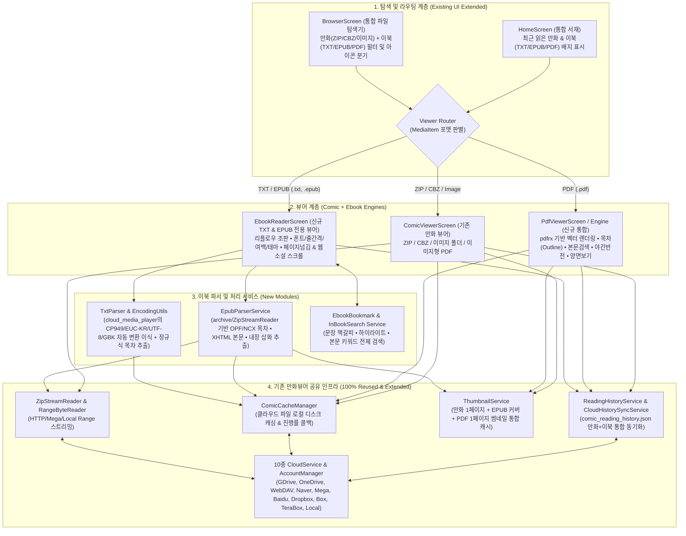

# Cloud Comic & Ebook Viewer 통합 아키텍처 설계서 (Integrated Plan)

> [!IMPORTANT]
> 본 문서는 별도의 신규 앱을 만드는 대신, 이미 완성도 높게 구축된 **`cloud_comic_viewer` (`D:\My Documents\AI\cloud_comic_viewer`)** 프로젝트 내부에 **`TXT / EPUB / PDF` 이북(eBook) 뷰어 엔진**을 직접 통합(Integration)하기 위한 상세 설계 및 구현 플랜입니다.

---

## 1. 왜 별도 앱 대신 `cloud_comic_viewer`에 통합하는 것이 최적인가?

기존 `cloud_comic_viewer` 코드를 분석한 결과, 만화뷰어와 이북뷰어는 인프라의 **85% 이상을 공유**하고 있어 통합 시 엄청난 시너지가 발생합니다.

1. **ZIP/압축 스트림 인프라(`ZipStreamReader`)와 EPUB의 구조적 동일성**:
   - **EPUB 파일은 본질적으로 ZIP 압축 파일**(`mimetype`, `META-INF/container.xml`, `OEBPS/*.xhtml`, `*.css`, `images/*`)입니다.
   - `cloud_comic_viewer`에 이미 구현된 `ZipStreamReader` (`LocalFileRangeReader`, `HttpCloudRangeReader`, `MegaCloudRangeReader`)와 `ComicCacheManager`를 그대로 활용하면, 클라우드(심지어 암호화된 Mega까지)에 있는 EPUB의 표지(Cover)나 특정 챕터를 전체 다운로드 전에도 Range 요청으로 즉시 추출할 수 있습니다.
2. **스캔본 PDF 만화책과 일반 텍스트 PDF 도서의 완벽한 통합**:
   - 만화책 역시 `.cbz/.zip` 외에 `.pdf` 포맷으로 배포되는 경우가 많고, 기존 `ComicViewerScreen`의 2페이지 양면 보기(`PageDisplayMode.spread`), 좌우 분할 보기(`split`), 핀치 줌(`InteractiveViewer`), 우$\rightarrow$좌(일본 만화) / 좌$\rightarrow$우 넘김 UX가 PDF 도서 열람에도 그대로 쓰입니다.
3. **단일 서재(HomeScreen) & 단일 클라우드 히스토리 동기화(`comic_reading_history.json`)**:
   - 사용자가 라이트노벨(TXT/EPUB)과 만화책(ZIP/CBZ/PDF)을 같은 클라우드 폴더나 계정에서 관리할 때, 앱을 두 개로 쪼개지 않고 **하나의 서재('최근 읽은 작품')에서 만화와 소설을 함께 이어보기** 할 수 있습니다.
   - 이미 구현된 툼스톤(Tombstone) 기반 양방향 동기화(`CloudHistorySyncService`)에 이북 진도 필드만 하위 호환되게 확장하면 추가 클라우드 API 작업 없이 즉시 동기화됩니다.

---

## 2. 통합 시스템 아키텍처 다이어그램



---

## 3. 기존 파일별 수정 및 확장 명세 (What Changes in `cloud_comic_viewer`)

### 3.1 `lib/models/media_item.dart` (포맷 판별 확장)
기존 `isComicArchive`, `isImage`에 더해 이북 포맷 게터(Getter)를 추가하고 `isViewable`을 확장합니다.
- **추가할 열거형**: `enum MediaBookType { comicArchive, imageFolder, txt, epub, pdf, unknown }`
- **추가할 게터**:
  - `bool get isTxt`: `.txt`, `.md` 확장자 또는 `mimeType == 'text/plain'`
  - `bool get isEpub`: `.epub` 확장자 또는 `mimeType == 'application/epub+zip'`
  - `bool get isPdf`: `.pdf` 확장자 또는 `mimeType == 'application/pdf'`
  - `bool get isEbook => isTxt || isEpub || isPdf;`
  - `bool get isViewable => isComicArchive || isImage || isEbook;` (기존 `BrowserScreen`의 열람 가능 필터 및 이전/다음 권 탐색 리스트(`_viewableSiblings`)와 자연스럽게 연동됨)

### 3.2 `lib/models/comic_reading_history.dart` (하위 호환 히스토리 모델 확장)
기존 `comic_reading_history.json` 포맷을 깨뜨리지 않으면서(하위 호환 100% 보장), 이북의 정밀한 위치(챕터, 글자 오프셋, 책갈피)를 함께 저장하도록 선택적(Nullable) 필드를 추가합니다.
- **기존 필드 유지**: `id`, `accountId`, `accountName`, `cloudType`, `title`, `parentFolderId`, `lastPage`, `totalPages`, `lastReadAt`, `coverThumbnailUrl`
- **신규 옵셔널 필드 추가**:
  - `String? bookType`: `'comic'`, `'txt'`, `'epub'`, `'pdf'` (기본값 `'comic'`)
  - `int? chapterIndex`: EPUB/TXT 현재 챕터 인덱스
  - `String? chapterTitle`: 현재 읽고 있는 챕터 제목 (예: `"제3장 던전 입장"` - 홈 화면 카드에 표시 시 직관성 극대화)
  - `int? charOffset`: TXT 또는 EPUB 챕터 내 문자 오프셋 (`0-based character index` — 기기 해상도나 폰트 크기가 바뀌어도 정확히 읽던 문장으로 복원하기 위한 핵심 값)
  - `List<EbookBookmark>? bookmarks`: 사용자가 등록한 책갈피 목록
- **진도율(`progress`) 계산 호환**:
  - TXT/EPUB에서도 전체 글자 수(또는 가상 페이지 수)를 `totalPages`에, 현재 읽은 글자 오프셋(또는 현재 가상 페이지)을 `lastPage`에 함께 기록하여, 기존 `HomeScreen` 및 `BrowserScreen`의 진행률 프로그레스 바(`progressPercent`)가 코드 수정 없이 그대로 작동하게 합니다.

### 3.3 `lib/models/viewer_settings.dart` (이북 조판 설정 통합)
기존 `ViewerSettings`(만화용 보기 모드/방향/테마)를 유지하면서, 텍스트/EPUB/PDF 전용 설정인 `EbookReaderSettings`를 추가하거나 `ViewerSettings` 내에 통합합니다.
- **공유 설정**:
  - `ViewerTheme` (기존 블랙, 다크그레이, 화이트, 세피아 + 신규 **눈보호 그린(`0xFFC7EDCC`)** 추가)
  - `ReadingDirection` (`leftToRight`, `rightToLeft`, `vertical` 웹소설/웹툰 스크롤)
  - `PageNavigationMode` (`leftRightTap`, `topBottomTap`, `swipeOnly`)
  - `keepScreenOn`, `showPageNumber`, `showClockAndBattery`
- **이북 전용 추가 설정 (`EbookStyleSettings`)**:
  - `double fontSize` (기본 `18.0`, 범위 `12.0 ~ 36.0`)
  - `double lineHeight` (줄간격, 기본 `1.6`, 범위 `1.2 ~ 2.4`)
  - `double paragraphSpacing` (문단 간격, 기본 `12.0`)
  - `double horizontalMargin` / `double verticalMargin` (좌우/상하 여백)
  - `String fontFamily` (시스템 기본, 본고딕/NotoSansKR, 본명조/NotoSerifKR, 리디바탕 등)
  - `bool justifyText` (양쪽 정렬 여부)
  - `bool useVolumeKeysForPageTurn` (물리 볼륨 버튼으로 페이지 넘김 - 만화 & 이북 공통 적용!)
  - `bool pdfDarkInvert` (PDF 야간 색상 반전 모드)

---

## 4. 포맷별 뷰어 구현 상세 플랜 (TXT / EPUB / PDF)

### 4.1 TXT 뷰어 (`lib/services/txt_parser_service.dart` & `lib/ui/screens/ebook_reader_screen.dart`)
1. **한글/다국어 인코딩 완벽 자동 감지 (`lib/utils/text_encoding_utils.dart`)**:
   - 기존 `cloud_media_player`의 `SubtitleUtils.decodeSubtitleToUtf8String()` 알고리즘을 이식합니다.
   - `UTF-8 (BOM)` $\rightarrow$ `Strict UTF-8` $\rightarrow$ `CP949` $\rightarrow$ `EUC-KR` $\rightarrow$ `GBK` $\rightarrow$ `UTF-16LE/BE` 순으로 자동 판별하여 옛날 텍스트 소설 파일도 한글 깨짐이 0%가 되도록 처리합니다. (상단 바에서 수동 인코딩 전환 메뉴도 제공)
2. **정규식 기반 자동 목차(Auto-TOC) 생성**:
   - 텍스트 본문을 스캔하여 `제1장`, `제 1 화`, `1권`, `Chapter 1`, `Episode 1`, `[001]`, ` 프롤로그`, `에필로그` 등의 패턴을 감지해 목차 드로어(Drawer)를 자동 생성합니다.
3. **가상 페이지네이션(좌우 넘김) & 웹소설 무한 스크롤(상하) 듀얼 모드**:
   - **좌우 페이지 넘김 모드**: 화면 크기(`LayoutBuilder`)와 폰트/줄간격/여백 설정을 기반으로 `TextPainter`를 사용해 현재 챕터/구간을 페이지 단위로 분할합니다.
   - **상하 웹소설 스크롤 모드**: 기존 `cloud_comic_viewer`에 이미 설치되어 있는 `scrollable_positioned_list` 패키지를 그대로 활용하여 수만 줄의 장편 텍스트도 메모리 점유 없이 즉시 점프 및 스크롤합니다.

### 4.2 EPUB 뷰어 (`lib/services/epub_parser_service.dart` & `lib/ui/screens/ebook_reader_screen.dart`)
1. **무설치/경량 자체 EPUB 파서 (기존 `archive` + `xml` 패키지 100% 활용)**:
   - 주목할 점: `cloud_comic_viewer`의 `pubspec.yaml`에는 이미 **`archive: ^4.4.0`**과 **`xml: ^7.1.0`**이 설치되어 있습니다!
   - 외부의 무겁고 구식인 `epubx` 패키지에 의존할 필요 없이(호환성 충돌 방지), 이미 설치된 `archive`(ZIP 해제) + `xml`(`META-INF/container.xml` $\rightarrow$ `.opf` 매니페스트/스파인 $\rightarrow$ `toc.ncx` / `nav.xhtml` 파싱) 조합으로 깔끔하고 빠른 자체 `EpubParserService`를 구현할 수 있습니다.
2. **EPUB 리플로우(Reflowable) 렌더링 & 내장 삽화(Illustration) 뷰어**:
   - 각 챕터의 XHTML에서 문단(`<p>`, `<h1>~<h6>`), 강조(`<b>`, `<i>`), 루비 문자(`<ruby>`), 이미지(``, `<svg><image>`)를 추출하여 네이티브 Flutter 위젯 트리(`RichText` / `SelectableText` + `InteractiveViewer` 이미지)로 렌더링합니다.
   - 라이트노벨 EPUB의 핵심인 **컬러/흑백 삽화 페이지**는 탭하면 기존 만화뷰어처럼 전체화면 핀치 줌(확대)이 가능하도록 연결합니다.
3. **EPUB 표지 썸네일 자동 추출 (`ThumbnailService` 연동)**:
   - OPF의 `<meta name="cover">` 또는 첫 번째 이미지를 추출하여 기존 `ThumbnailService.saveCoverThumbnail()`에 저장함으로써, 서재(`HomeScreen`)와 탐색기에서 EPUB 표지가 예쁘게 표시되도록 합니다.

### 4.3 PDF 뷰어 (`lib/ui/screens/pdf_viewer_screen.dart` 또는 `ComicViewerScreen` 통합)
1. **고성능 PDF 엔진(`pdfrx`) 연동**:
   - `ComicCacheManager.loadOrDownloadComicBytes()`를 통해 클라우드 PDF를 로컬 캐시 파일로 받은 뒤 `pdfrx`로 오픈합니다.
2. **만화형 PDF vs 문서형 PDF 모두 만족하는 기능**:
   - **만화책 스캔 PDF**: 기존 만화뷰어의 **좌$\leftrightarrow$우 / 우$\leftrightarrow$좌 읽기 방향**, **태블릿/PC 두 페이지 펼쳐보기(Spread)**, **웹툰식 세로 연속 스크롤** 지원.
   - **일반 도서/전공서 PDF**: **내장 목차(Outline) 사이드바**, **본문 텍스트 검색 및 하이라이트**, **야간 다크 모드(색상 반전 필터)**, **페이지 여백 자르기(줌 고정)** 지원.
   - **표지 썸네일**: PDF 열람 시 1페이지를 이미지로 렌더링하여 `ThumbnailService`에 자동 저장합니다.

---

## 5. UI / UX 통합 설계 (HomeScreen & BrowserScreen & Viewer)

### 5.1 파일 탐색기 (`BrowserScreen`) 및 서재 (`HomeScreen`) 시각적 구분
만화 파일과 이북 파일이 한 폴더에 섞여 있어도 한눈에 구분할 수 있도록 배지(Badge)와 아이콘 색상을 부여합니다.
| 파일 종류 | 확장자 | 아이콘 / 배지 컬러 | 클릭 시 동작 |
| :--- | :--- | :--- | :--- |
| **만화 압축 / 폴더** | `.zip`, `.cbz`, `.rar`, `.cbr`, 이미지 폴더 | 🟣 보라/블루 (`COMIC` 배지) | 기존 `ComicViewerScreen` 실행 |
| **텍스트 소설** | `.txt`, `.md` | 🟢 에메랄드 그린 (`TXT` 배지) | 신규 `EbookReaderScreen` (TXT 모드) 실행 |
| **EPUB 전자책** | `.epub` | 🟠 앰버/오렌지 (`EPUB` 배지) | 신규 `EbookReaderScreen` (EPUB 모드) 실행 |
| **PDF 문서/만화** | `.pdf` | 🔴 코랄 레드 (`PDF` 배지) | 신규 `PdfViewerScreen` 실행 |

- **폴더 내 이전 권 / 다음 권 자동 이동 (`_viewableSiblings`)**:
  - `ComicViewerScreen`, `EbookReaderScreen`, `PdfViewerScreen` 모두 하단 컨트롤 바의 **`[⏮ 이전 권]`** / **`[다음 권 ⏭]`** 버튼을 공유합니다.
  - 예를 들어 `소설 1권.epub`을 다 읽고 `[다음 권]`을 누르면 같은 클라우드 폴더 내의 `소설 2권.epub`이 즉시 열립니다.

### 5.2 이북 뷰어 화면 (`EbookReaderScreen`) 레이아웃
기존 `ComicViewerScreen`의 깔끔한 플로팅 HUD 디자인 통일성을 그대로 유지합니다.
```text
+-------------------------------------------------------------------+
| [←] 소설 제목 - 제12장 이중 던전         [🔍검색] [🔖북마크] [🔤인코딩] [☰목차] |  <-- 상단 플로팅 바
+-------------------------------------------------------------------+
|                                                                   |
|   성진우는 숨을 죽이고 제단 앞의 거대한 석상을 바라보았다.              |
|   클라우드에서 실시간으로 불러온 텍스트와 EPUB 파일이 사용자가 설정한      |
|   폰트와 줄간격, 눈이 편안한 세피아/다크 테마로 깔끔하게 조판됩니다.      |
|                                                                   |
|   [좌측 1/3 터치: 이전 페이지]   [중앙: 메뉴]   [우측 1/3 터치: 다음 페이지] |
|                                                                   |
|   (EPUB 내장 삽화가 있을 경우 고해상도 이미지 렌더링 & 탭하여 확대)      |
|                                                                   |
+-------------------------------------------------------------------+
|  제12장 • 42.5%                              14:35  🔋 88%  128 / 301 |  <-- 하단 마이크로 상태바
+-------------------------------------------------------------------+
|  [⏮ 이전 권]   [ < ]  =======●===========  [ > ]   [다음 권 ⏭]     |  <-- 하단 플로팅 컨트롤 바
|                [ 📑 목차/책갈피 ]   [ Aa 뷰어/폰트 설정 ]            |
+-------------------------------------------------------------------+
```

---

## 6. 디렉터리 및 파일 구조 변경안 (`D:\My Documents\AI\cloud_comic_viewer`)

기존 프로젝트 구조를 그대로 유지하면서 **굵은 글씨(`✨ [신규]` / `🔧 [확장]`)** 항목만 추가/수정합니다.

```text
D:\My Documents\AI\cloud_comic_viewer\
├── lib/
│   ├── main.dart
│   ├── models/
│   │   ├── cloud_account.dart                   # [유지] 10종 클라우드 계정 모델
│   │   ├── comic_page.dart                      # [유지] 만화 페이지 모델
│   │   ├── comic_reading_history.dart           # 🔧 [확장] bookType, chapterIndex, chapterTitle, charOffset, bookmarks 추가
│   │   ├── display_page_item.dart               # [유지] 만화 분할/양면 페이지 아이템
│   │   ├── ebook_content.dart                   # ✨ [신규] TXT/EPUB 파싱 결과 모델 (챕터 리스트, 문단/인라인 블록, 내장 이미지 맵, 책갈피)
│   │   ├── folder_shortcut.dart                 # [유지] 폴더 바로가기 모델
│   │   ├── media_item.dart                      # 🔧 [확장] isTxt, isEpub, isPdf, isEbook 및 MediaBookType 판별 추가
│   │   └── viewer_settings.dart                 # 🔧 [확장] 이북 조판 설정 (fontSize, lineHeight, margin, fontFamily, greenTheme, volumeKeyTurn) 추가
│   ├── services/
│   │   ├── (10종 클라우드 서비스 & 인증 매니저)    # [유지] GDrive, OneDrive, WebDAV, Naver, Mega, Baidu, Dropbox, Box, TeraBox, Local
│   │   ├── cloud_history_sync_service.dart      # [유지] ComicReadingHistory.toJson() 확장으로 자동 반영
│   │   ├── comic_archive_service.dart           # [유지] 만화 ZIP 파서
│   │   ├── comic_cache_manager.dart             # 🔧 [확장] 만화뿐만 아니라 TXT/EPUB/PDF 파일 캐싱 및 로컬 File 반환 헬퍼 공유
│   │   ├── epub_parser_service.dart             # ✨ [신규] archive + xml 기반 EPUB 컨테이너/OPF/NCX/XHTML/삽화/표지 파서
│   │   ├── reading_history_service.dart         # 🔧 [확장] updateProgress()에 이북 위치(charOffset, chapter, bookmarks) 파라미터 추가
│   │   ├── thumbnail_service.dart               # [유지] EPUB 표지 및 PDF 1페이지 썸네일 저장에도 동일하게 사용
│   │   ├── txt_parser_service.dart              # ✨ [신규] 대용량 TXT 로딩, 정규식 자동 목차(Chapter) 분할, 문단 정리 서비스
│   │   ├── viewer_settings_service.dart         # 🔧 [확장] 이북 조판 설정 저장/불러오기 메서드 추가
│   │   └── zip_stream_reader.dart               # [유지] 만화 & EPUB 스트림 리더
│   ├── ui/
│   │   ├── screens/
│   │   │   ├── home_screen.dart                 # 🔧 [확장] 최근 읽은 작품 클릭 시 포맷별 뷰어 분기 & 배지(COMIC/TXT/EPUB/PDF) 표시
│   │   │   ├── browser_screen.dart              # 🔧 [확장] 파일 클릭 시 포맷별 뷰어 라우팅 & 파일 아이콘/배지 표시
│   │   │   ├── comic_viewer_screen.dart         # [유지] 기존 만화 전용 뷰어 (+ 볼륨키 페이지 넘김 옵션 연동)
│   │   │   ├── ebook_reader_screen.dart         # ✨ [신규] TXT & EPUB 통합 리더 화면 (가상 페이지네이션 + 웹소설 스크롤 + 검색 + 책갈피)
│   │   │   └── pdf_viewer_screen.dart           # ✨ [신규] pdfrx 기반 고성능 PDF 뷰어 화면 (목차 + 검색 + 다크모드 + 양면보기)
│   │   └── widgets/
│   │       ├── comic_thumbnail_sheet.dart       # [유지] 만화 썸네일 시트
│   │       ├── viewer_settings_dialog.dart      # [유지] 만화 뷰어 설정 다이얼로그
│   │       ├── ebook_settings_sheet.dart        # ✨ [신규] 이북 전용 조판 설정 바텀시트 (폰트 크기, 줄간격, 여백, 테마, 넘김방식)
│   │       └── ebook_toc_drawer.dart            # ✨ [신규] 이북/PDF 목차(TOC) + 책갈피(Bookmark) + 본문 검색 통합 시트/드로어
│   └── utils/
│       ├── text_encoding_utils.dart             # ✨ [신규] cloud_media_player의 SubtitleUtils 기반 UTF-8/CP949/EUC-KR/GBK 자동 변환기
│       ├── natural_sort_utils.dart              # [유지] 권수 자연 정렬
│       ├── mega_crypto_utils.dart               # [유지] Mega 복호화
│       └── ...
└── pubspec.yaml                                 # 🔧 [확장] charset_converter, fast_gbk, pdfrx (총 3개 패키지만 추가)
```

---

## 7. 패키지 추가 최소화 전략 (`pubspec.yaml`)

기존 `cloud_comic_viewer`에 이미 `archive`, `xml`, `scrollable_positioned_list`, `photo_view`, `screen_brightness`가 모두 들어 있으므로, **단 3개의 검증된 패키지**만 추가하면 모든 기능을 구현할 수 있습니다.

1. **`charset_converter: ^2.5.1`** & **`fast_gbk: ^1.0.0`**:
   - 이미 `cloud_media_player`에서 검증된 한글(`CP949`, `EUC-KR`) 및 다국어 텍스트 인코딩 디코더.
2. **`pdfrx: ^1.0.101`** (또는 호환 최신 버전):
   - Android / Windows 데스크톱 모두 지원하는 PDFium 기반 초고속 PDF 렌더링 엔진.
3. *(EPUB 파싱은 기존 `archive: ^4.4.0` + `xml: ^7.1.0`으로 직접 처리하여 외부 패키지 의존성 문제를 원천 차단합니다.)*

---

## 8. 단계별 구현 로드맵 (Implementation Roadmap)

향후 코딩 진행 시 아래 4단계로 깔끔하게 통합합니다.

- **Step 1: 모델/유틸 확장 및 라우팅 기반 구축**
  - `pubspec.yaml`에 `charset_converter`, `fast_gbk`, `pdfrx` 추가.
  - `MediaItem`에 `isTxt`, `isEpub`, `isPdf`, `isEbook` 추가 및 `ComicReadingHistory`, `ViewerSettings` 확장.
  - `TextEncodingUtils` (UTF-8 / CP949 / EUC-KR / GBK 자동 감지 디코더) 구현.
- **Step 2: TXT & EPUB 파서 및 `EbookReaderScreen` 구현**
  - `TxtParserService` (인코딩 변환 + 정규식 챕터 자동 추출) 및 `EpubParserService` (`archive` + `xml` 기반 OPF/NCX 목차, XHTML 본문, 내장 삽화, 표지 추출) 구현.
  - `EbookReaderScreen` 구현: 좌우 페이지 넘김(가상 페이지네이션) & 상하 웹소설 스크롤 모드, 타이포그래피/테마 설정 시트(`EbookSettingsSheet`), 목차/책갈피/본문검색 시트(`EbookTocDrawer`) 구현.
- **Step 3: PDF 뷰어 (`PdfViewerScreen`) 구현**
  - `pdfrx` 기반 고속 PDF 뷰어, 내장 Outline 목차 이동, 다크 모드 색상 반전 필터, 양면 보기, 1페이지 표지 썸네일 자동 저장 구현.
- **Step 4: 서재(`HomeScreen`) & 탐색기(`BrowserScreen`) 통합 연결 및 테스트**
  - `BrowserScreen`과 `HomeScreen`에서 파일 포맷에 따라 `ComicViewerScreen` / `EbookReaderScreen` / `PdfViewerScreen`으로 자동 라우팅하고 파일 포맷 배지(`COMIC`, `TXT`, `EPUB`, `PDF`) 표시.
  - 이전 권 / 다음 권 이어보기 및 클라우드 진도 동기화(`comic_reading_history.json`) 통합 검증.
